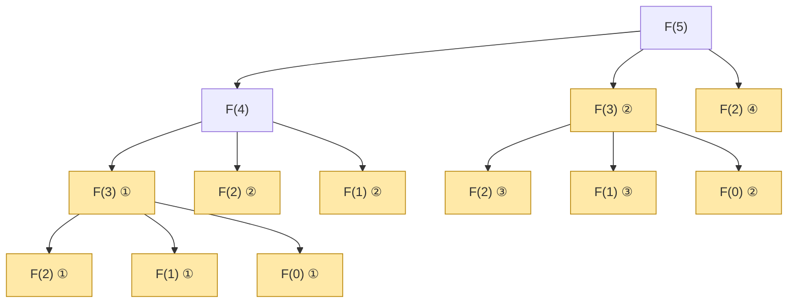
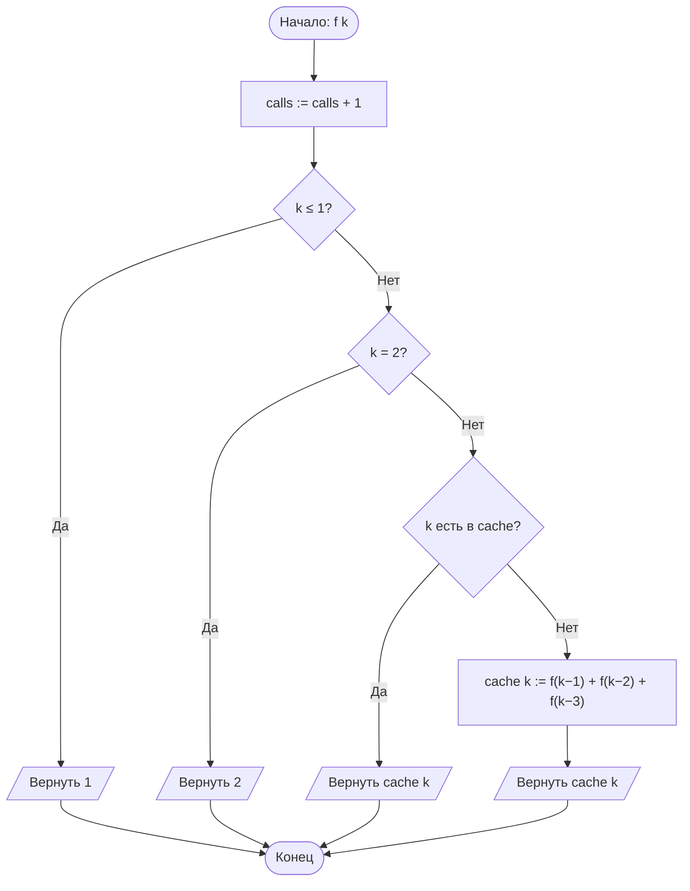
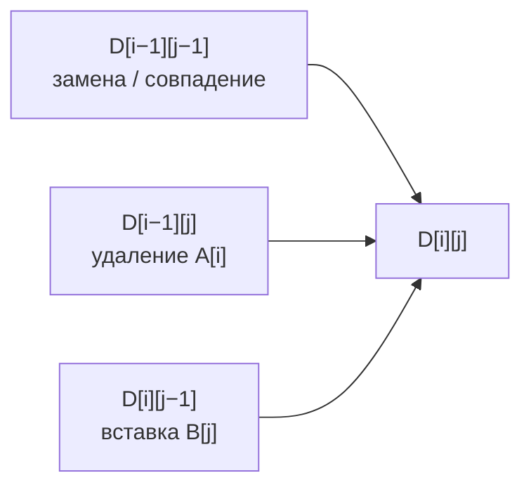
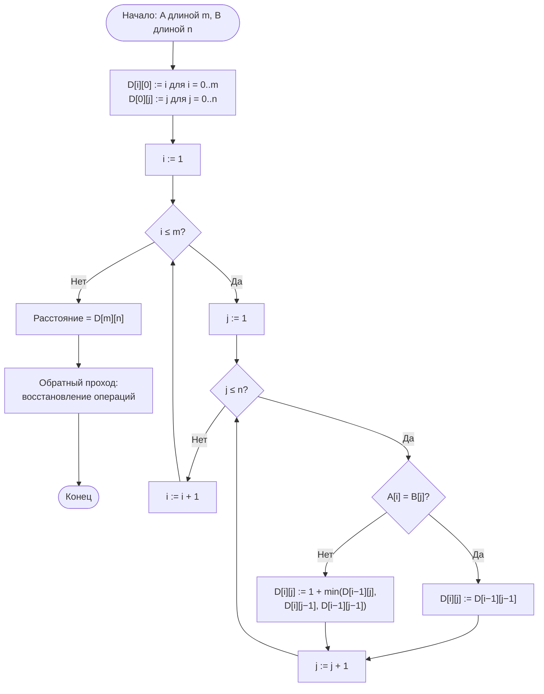
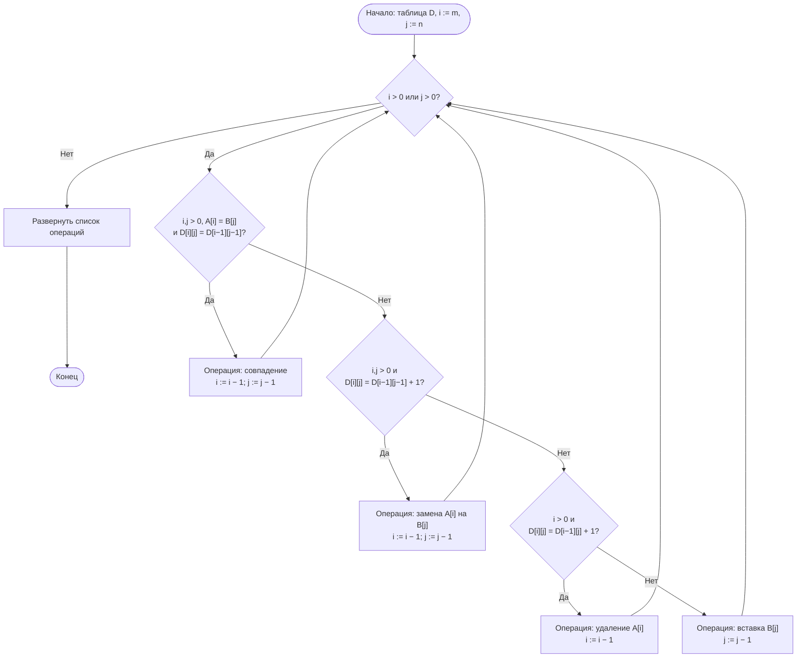

# Лабораторная работа № 7. Вариант 13

**Рекурсивные алгоритмы и динамическое программирование в задачах комбинаторной оптимизации**

| | |
|---|---|
| **Дисциплина** | Теория алгоритмов |
| **Направление** | 38.03.05 «Бизнес-информатика» |
| **Выполнила** | Кугушева Арина Вячеславовна, группа БИ 2-1 |
| **Вариант** | 13 |

## Файлы

| Файл | Назначение |
|---|---|
| `lr7_variant13.py` | программа: алгоритмы, генерация данных, самопроверка, эксперименты, графики |
| `otchet_lr7_variant13.pdf` | отчёт по требованиям задания |
| `README.md` | этот файл |

## Запуск

```bash
pip install matplotlib
python lr7_variant13.py
```

Полный прогон занимает около 1–1,5 минуты; программа печатает характеристики системы и таблицы результатов и сохраняет графики `lr7_plot_stairs.png`, `lr7_plot_edit.png` и `lr7_plot_cache.png`. Параметр `--json FILE` сохраняет результаты в JSON, `--show` показывает графики на экране.


## 1. Цель работы и задание варианта

**Цель работы:** изучить динамическое программирование как способ устранения повторных вычислений в рекурсивных алгоритмах и экспериментально сопоставить три реализации одной задачи — наивную рекурсивную, рекурсивную с мемоизацией и итеративную; решить задачу дискретной оптимизации с восстановлением оптимального решения.

**Задание (вариант 13).** **Задача А:** число способов подняться по лестнице из n ступеней шагами по 1, 2 или 3 ступени; реализовать тремя способами с подсчётом вызовов, n = 10…27, определить предел наивной рекурсии (ориентир — 10 с). **Задача Б:** редакционное расстояние (расстояние Левенштейна) между двумя строками длиной 300 символов — решить методом ДП, восстановить последовательность операций, сверить с полным перебором на малых строках. **Дополнительное задание Г6:** сравнить собственную мемоизацию с декоратором `functools.lru_cache` и объяснить разницу во времени.

| № | Задача А | Параметр n | Задача Б | Данные задачи Б | Доп. |
|---|---|---|---|---|---|
| 13 | Лестница, шаги 1, 2, 3 | 10…27 | Редакционное расстояние | Строки длиной 300 | Г6 |

**Условия эксперимента.** Время измерялось функцией `time.perf_counter()`. Для быстрых вариантов вызов повторяли серией и брали медиану по пяти сериям; для наивной рекурсии при n ≥ 26 — одиночный замер. Каждая реализация задачи А возвращает пару «значение, число вызовов»; у итеративной версии вместо числа вызовов считаются шаги цикла (вызов один). Строка A длиной 300 — случайный текст над русским алфавитом (27 букв, генератор с начальным значением 13); строка B получена из A тридцатью случайными правками (замены и «сдвиги» символа) при сохранении длины. Для сверки с полным перебором использовались 200 пар случайных строк длиной до 7 символов.


## 2. Рекуррентные соотношения

**Задача А.** Пусть f(n) — число способов подняться на n-ю ступень шагами по 1, 2 или 3 ступени. На n-ю ступень можно попасть с ступени n − 1 (шаг 1), n − 2 (шаг 2) или n − 3 (шаг 3), и эти группы способов не пересекаются, поэтому

f(n) = f(n − 1) + f(n − 2) + f(n − 3), f(0) = f(1) = 1, f(2) = 2.

Слагаемые: f(n − 1) — способы, у которых последний шаг равен 1; f(n − 2) — последний шаг 2; f(n − 3) — последний шаг 3. Базовые значения: на нулевой ступени (старт) и на первой — единственный способ; на второй — два (1 + 1 или 2). Первые значения: 1, 1, 2, 4, 7, 13, 24, …

**Число вызовов наивной рекурсии** удовлетворяет соотношению T(n) = 1 + T(n − 1) + T(n − 2) + T(n − 3), T(0) = T(1) = T(2) = 1 (единица — сам вызов), и растёт как Θ(c<sup>n</sup>), где c ≈ 1,8393 — действительный корень уравнения x³ = x² + x + 1 (постоянная «трибоначчи»). **С мемоизацией** нетривиальных подзадач (k = 3…n) всего n − 2, каждая вычисляется один раз и порождает три вызова, поэтому число вызовов равно 1 + 3(n − 2) = 3n − 5 = Θ(n). **Итеративная версия** выполняет n − 2 шага цикла и хранит три последних значения: Θ(n) времени, O(1) памяти.

**Задача Б.** Пусть D[i][j] — минимальное число операций (вставка, удаление, замена одного символа, цена каждой 1), превращающих первые i символов строки A в первые j символов строки B. Тогда

D[i][0] = i, D[0][j] = j,

D[i][j] = D[i − 1][j − 1], если A[i] = B[j]; D[i][j] = 1 + min(D[i − 1][j], D[i][j − 1], D[i − 1][j − 1]) иначе.

Слагаемые: D[i − 1][j] + 1 — *удаление* символа A[i]; D[i][j − 1] + 1 — *вставка* символа B[j] в конец; D[i − 1][j − 1] + 1 — *замена* A[i] на B[j]; при A[i] = B[j] последние символы совпадают, и расстояние равно расстоянию между более короткими префиксами (это не хуже любой операции). Граничные значения: превратить пустую строку в j символов — j вставок, i символов в пустую — i удалений. Ответ — D[m][n]. Свойства динамического программирования выполнены: оптимальная подструктура (оптимальное преобразование префиксов содержит оптимальные преобразования более коротких префиксов) и перекрывающиеся подзадачи ((m + 1)(n + 1) различных пар (i, j) при экспоненциальном числе путей в рекурсии). Трудоёмкость таблицы Θ(mn) по времени и памяти (при m = n = 300 — 90 601 клетка); двухстрочная версия использует O(n) памяти, но не позволяет восстановить операции. Наивная рекурсия делает порядка (3 + 2√2)<sup>n</sup> ≈ 5,83<sup>n</sup> вызовов.

**Восстановление решения.** Обратный проход от клетки (m, n) к (0, 0): если A[i] = B[j] и D[i][j] = D[i − 1][j − 1] — совпадение; иначе если D[i][j] = D[i − 1][j − 1] + 1 — замена; иначе если D[i][j] = D[i − 1][j] + 1 — удаление; иначе — вставка (приоритет при равенстве фиксирован, поэтому результат воспроизводим).


## 3. Дерево рекурсии и блок-схемы



*Рис. 1. Дерево рекурсии наивной версии для f(5): 13 вызовов; повторяющиеся подзадачи выделены цветом и пронумерованы (F(3) — 2 раза, F(2) — 4 раза, F(1) — 3 раза, F(0) — 2 раза)*

На рис. 1 подзадача F(3) решается дважды, F(2) — четыре раза, F(1) — трижды, F(0) — дважды. При мемоизации каждая подзадача вычисляется один раз, и дерево вырождается в «позвоночник» F(5) → F(4) → F(3) с обращениями к кэшу вместо повторных поддеревьев.



*Рис. 2. Блок-схема мемоизированной функции задачи А*



*Рис. 3. Схема зависимости клетки таблицы D[i][j] от трёх соседних клеток*



*Рис. 4. Блок-схема заполнения таблицы ДП для редакционного расстояния*



*Рис. 5. Блок-схема восстановления последовательности операций (обратный проход)*


## 4. Листинг программы

Файл `lr7_variant13.py` (самодостаточный модуль с подробными комментариями: три реализации задачи А, четыре реализации задачи Б, восстановление решения, мемоизации для сравнения, самопроверка, эксперименты, графики). Запуск: `python lr7_variant13.py`; требуется matplotlib.

Полный текст программы — в файле [`lr7_variant13.py`](lr7_variant13.py).


## 5. Характеристики вычислительной системы

| Параметр | Значение |
|---|---|
| Процессор | Intel(R) Xeon(R) Processor @ 2.10GHz, 2 логических ядра |
| Оперативная память | 8 ГБ |
| Операционная система | Linux (Ubuntu 24.04) |
| Интерпретатор | Python 3.13.18 |
| Таймер | time.perf_counter() |

*Абсолютные значения времени зависят от системы; числа вызовов, значения f(n) и расстояние не зависят от неё вообще, а форма роста времени и соотношения между реализациями должны сохраниться. Программа при запуске выводит характеристики системы автоматически.*


## 6. Результаты измерений

6.1. Задача А: лестница с шагами 1, 2, 3

**Таблица 1. Число вызовов и время трёх реализаций**

| n | f(n) | Вызовов, наивная | Вызовов, мемоизация (3n − 5) | Шагов цикла, итеративная | Время, наивная, мс | Время, мемоизация, мкс | Время, итеративная, мкс |
|---|---|---|---|---|---|---|---|
| 10 | 274 | 289 | 25 | 9 | 0,022 | 3,28 | 0,44 |
| 11 | 504 | 532 | 28 | 10 | 0,040 | 3,65 | 0,48 |
| 12 | 927 | 979 | 31 | 11 | 0,076 | 3,97 | 0,56 |
| 13 | 1 705 | 1 801 | 34 | 12 | 0,145 | 4,44 | 0,58 |
| 14 | 3 136 | 3 313 | 37 | 13 | 0,259 | 4,69 | 0,63 |
| 15 | 5 768 | 6 094 | 40 | 14 | 0,486 | 5,86 | 0,72 |
| 16 | 10 609 | 11 209 | 43 | 15 | 0,889 | 5,59 | 0,74 |
| 17 | 19 513 | 20 617 | 46 | 16 | 1,716 | 5,76 | 1,42 |
| 18 | 35 890 | 37 921 | 49 | 17 | 2,946 | 6,13 | 0,87 |
| 19 | 66 012 | 69 748 | 52 | 18 | 5,424 | 6,39 | 0,93 |
| 20 | 121 415 | 128 287 | 55 | 19 | 10,667 | 7,08 | 0,99 |
| 21 | 223 317 | 235 957 | 58 | 20 | 18,859 | 7,19 | 1,02 |
| 22 | 410 744 | 433 993 | 61 | 21 | 33,944 | 7,57 | 1,06 |
| 23 | 755 476 | 798 238 | 64 | 22 | 63,974 | 7,91 | 1,15 |
| 24 | 1 389 537 | 1 468 189 | 67 | 23 | 118,721 | 8,39 | 1,20 |
| 25 | 2 555 757 | 2 700 421 | 70 | 24 | 219,485 | 8,49 | 1,22 |
| 26 | 4 700 770 | 4 966 849 | 73 | 25 | 447,027 | 10,01 | 1,28 |
| 27 | 8 646 064 | 9 135 460 | 76 | 26 | 778,871 | 9,39 | 1,67 |

Число вызовов наивной версии полностью совпадает с формулой T(n) = 1 + T(n − 1) + T(n − 2) + T(n − 3) (проверено программой для каждого n), а мемоизированной — с 3n − 5. Отношение T(n + 1)/T(n) при n = 27 равно 1,8393, среднее по всему диапазону — 1,8395, оценка по наклону прямой log T(n) — 1,8394; теоретическое значение постоянной трибоначчи 1,8393.


*Рис. 6. Задача А: число вызовов и время работы (логарифмические шкалы). Штриховая линия — c<sup>n</sup>, c = 1,839*

**Таблица 2. Предел наивной рекурсии (порог 10 с)**

| n | Вызовов | Время, с | Результат |
|---|---|---|---|
| 28 | 16 802 731 | 1,35 | в пределах 10 с |
| 29 | 30 905 041 | 2,60 | в пределах 10 с |
| 30 | 56 843 233 | 4,65 | в пределах 10 с |
| 31 | 104 551 006 | 8,39 | в пределах 10 с |
| 32 | 192 299 281 | 15,85 | **больше 10 с** |

Наивная рекурсия перестаёт завершаться за 10 секунд при n = 32 (15,8 с); при n = 31 она ещё укладывается (8,4 с). Для сравнения, мемоизация и итеративная версия при n = 32 занимают микросекунды.

6.2. Задача Б: редакционное расстояние

**Малый пример.** Слова «СОБАКА» → «ЛОПАТА»: расстояние 3 (замены С→Л, Б→П, К→Т); таблица ДП:

|  | · | Л | О | П | А | Т | А |
|---|---|---|---|---|---|---|---|
| · | 0 | 1 | 2 | 3 | 4 | 5 | 6 |
| С | 1 | 1 | 2 | 3 | 4 | 5 | 6 |
| О | 2 | 2 | 1 | 2 | 3 | 4 | 5 |
| Б | 3 | 3 | 2 | 2 | 3 | 4 | 5 |
| А | 4 | 4 | 3 | 3 | 2 | 3 | 4 |
| К | 5 | 5 | 4 | 4 | 3 | 3 | 4 |
| А | 6 | 6 | 5 | 5 | 4 | 4 | 3 |

**Таблица 3. Малые длины: полный перебор, мемоизация, таблица (строки без общих символов — худший случай для перебора)**

| L | D | Вызовов, перебор | Вызовов, мемоизация | Клеток таблицы (L+1)² | Время, перебор, мкс | Время, мемоизация, мкс | Время, таблица, мкс |
|---|---|---|---|---|---|---|---|
| 2 | 2 | 19 | 13 | 9 | 3,2 | 3,4 | 1,4 |
| 3 | 3 | 94 | 28 | 16 | 11,6 | 6,9 | 2,4 |
| 4 | 4 | 481 | 49 | 25 | 58,7 | 11,8 | 3,5 |
| 5 | 5 | 2 524 | 76 | 36 | 313,2 | 19,1 | 4,7 |
| 6 | 6 | 13 483 | 109 | 49 | 1636,8 | 25,3 | 6,4 |
| 7 | 7 | 72 958 | 148 | 64 | 8858,3 | 34,6 | 8,2 |
| 8 | 8 | 398 593 | 193 | 81 | 49027,0 | 44,8 | 10,3 |

Число вызовов перебора растёт в ≈ 5,5 раза при увеличении длины на 1 (теория ≈ 5,83), при L = 8 это уже 398 593 вызовов против 81 клеток таблицы. Для L = 300 перебор невозможен: порядка 5,83<sup>300</sup> вызовов.

**Таблица 4. Рост времени ДП с длиной строк (случайные строки, ожидается Θ(L²))**

| L | Клеток | Таблица, мс | Две строки, мс | Время / клетка, нс |
|---|---|---|---|---|
| 50 | 2 601 | 0,34 | 0,30 | 131 |
| 100 | 10 201 | 1,19 | 1,25 | 117 |
| 150 | 22 801 | 2,70 | 2,75 | 118 |
| 200 | 40 401 | 4,86 | 5,04 | 120 |
| 300 | 90 601 | 11,70 | 11,97 | 129 |
| 400 | 160 801 | 23,71 | 21,44 | 147 |


*Рис. 7. Задача Б: число вызовов на малых длинах (слева) и рост времени ДП с длиной строк (справа, штриховая линия — ∝ L²)*

6.3. Дополнительное задание Г6: собственная мемоизация и `lru_cache`

Сравниваются три способа мемоизации одной и той же рекурсии: **собственный декоратор** `my_memoize` (обёртка на чистом Python со словарём), **functools.lru_cache(maxsize=None)** и **явный словарь внутри функции** (`stairs_memo`, `edit_memo`). Время — медиана вычисления с *пустым* кэшем.

**Таблица 5. Задача А: время вычисления f(n) с пустым кэшем, мкс**

| n | Собственный декоратор | lru_cache | Явный словарь | Обращений к функции | Реальных вычислений | own / lru |
|---|---|---|---|---|---|---|
| 27 | 13,00 | 5,80 | 9,34 | 76 | 28 | 2,24 |
| 100 | 50,74 | 21,48 | 35,60 | 295 | 101 | 2,36 |
| 300 | 200,48 | 76,29 | 131,24 | 895 | 301 | 2,63 |
| 900 | 716,57 | 324,12 | 516,69 | 2695 | 901 | 2,21 |

**Таблица 6. Задача Б: время вычисления редакционного расстояния со случайными строками, мс**

| L | Собственный декоратор | lru_cache | Явный словарь | Таблица (ДП) | Обращений | Вычислений | own / lru |
|---|---|---|---|---|---|---|---|
| 100 | 8,02 | 4,26 | 6,86 | 1,16 | 28 590 | 9 939 | 1,88 |
| 200 | 35,93 | 27,91 | 32,50 | 4,72 | 112 887 | 38 969 | 1,29 |
| 300 | 89,41 | 53,80 | 73,92 | 11,02 | 253 898 | 87 281 | 1,66 |


*Рис. 8. Г6: время мемоизированных реализаций (логарифмическая шкала)*

**Объяснение разницы.** Число вычислений у всех мемоизаций одинаково (n + 1 для задачи А; 87 281 различных пар (i, j), достижимых из (300, 300), для задачи Б): мемоизация убирает повторные вычисления в любой форме. Различается стоимость *одного обращения* к кэшу. У `lru_cache` обёртка написана на языке C: формирование ключа из аргументов, поиск в словаре и возврат закэшированного значения выполняются без создания кадра Python-функции. Собственный декоратор — это обычная функция Python: при каждом обращении создаётся кадр обёртки, упаковываются аргументы `*args`, обновляются счётчики, выполняются проверка `in` и повторное чтение словаря, а при промахе добавляется ещё вызов исходной функции — на каждый уровень рекурсии приходится два кадра Python. Поэтому `lru_cache` быстрее собственного декоратора в 1,3–2,6 раза. Явный словарь внутри функции быстрее декоратора (нет лишнего кадра и счётчиков), но медленнее `lru_cache`; а восходящая таблица без рекурсии быстрее лучшей мемоизации примерно в 4,9 раза при L = 300.


## 7. Оптимальное решение задачи Б (с расшифровкой)

Строки длиной 300 символов; B получена из A тридцатью случайными правками.

**Строка A:**

```text
икццюехзцдзхшедвтжшкаодяцфаиядвюююияпшодюимзрэтуоцмохлхгмяфюхичптфшдпцшптекжесмимпифиндурт
зузжчмдвоххпнашобздрючяпхиешошиэюмжчхмсчцдчфзшржфбучубмушулекжеюцтгзевохфтютчбпялхвсадкгок
иуфчврсмябаллдрттсярзцжкюбнсчешдиоцяжиоузмэзукожхмоблнпввэбфахэкжпртнлбксоддбгмяежккфнкбмд
гмрпууобмткдюблетшдазцдврмвмию
```

**Строка B:**

```text
икццюехгзцдрхтшедвжшгкаодяфамдвюююияпшодюримзрэлтуоцмаохлхгмяфюичпфшдпцшпцтекифсмимфпифину
ртзузжчамдвохухпнашочбздрючяпхиешошиэцмжчхмсичцдчфзшржбучубмушлекжтаютгзевохфтютчбпялхвсад
кгокиуфчврсмзаллдрттснрзцжкюбнсчешдиоцяэжузмэзукжхмобнпввджбфахэжпрятялбксоддгмяежккфнкюбм
дгмрнуобмтбдюблетшдазцдврмвмию
```

**Редакционное расстояние D[300][300] = 46.** Оптимальная последовательность состоит из 46 операций: замен — 16, удалений — 15, вставок — 15; ещё 269 символов остаются без изменений (всего 315 шагов пути по таблице). Для двух независимых случайных строк той же длины расстояние составило бы 270. Применение полученной последовательности к строке A даёт в точности строку B (проверено программой), а её цена равна D[300][300]. Позиции указаны в исходных строках (с 1); при вставке указана позиция в A, *после* которой вставляется символ.

**Таблица 7. Расшифровка оптимального решения (операции без учёта совпадений)**

| № | Операция | Поз. A | Симв. A | Поз. B | Симв. B |
|---|---|---|---|---|---|
| 1 | вставка | после 7 | — | 8 | г |
| 2 | замена | 11 | з | 12 | р |
| 3 | вставка | после 12 | — | 14 | т |
| 4 | удаление | 17 | т | — | — |
| 5 | вставка | после 19 | — | 21 | г |
| 6 | удаление | 25 | ц | — | — |
| 7 | удаление | 28 | и | — | — |
| 8 | замена | 29 | я | 29 | м |
| 9 | вставка | после 41 | — | 42 | р |
| 10 | вставка | после 46 | — | 48 | л |
| 11 | вставка | после 51 | — | 54 | а |
| 12 | удаление | 61 | х | — | — |
| 13 | удаление | 65 | т | — | — |
| 14 | вставка | после 72 | — | 74 | ц |
| 15 | замена | 76 | ж | 78 | и |
| 16 | замена | 77 | е | 79 | ф |
| 17 | вставка | после 81 | — | 84 | ф |
| 18 | удаление | 87 | д | — | — |
| 19 | вставка | после 95 | — | 98 | а |
| 20 | вставка | после 100 | — | 104 | у |
| 21 | вставка | после 106 | — | 111 | ч |
| 22 | замена | 123 | ю | 128 | ц |
| 23 | вставка | после 129 | — | 135 | и |
| 24 | удаление | 139 | ф | — | — |
| 25 | удаление | 148 | у | — | — |
| 26 | замена | 153 | е | 157 | т |
| 27 | замена | 154 | ю | 158 | а |
| 28 | замена | 155 | ц | 159 | ю |
| 29 | удаление | 189 | я | — | — |
| 30 | замена | 190 | б | 193 | з |
| 31 | замена | 199 | я | 202 | н |
| 32 | удаление | 217 | ж | — | — |
| 33 | замена | 218 | и | 220 | э |
| 34 | замена | 219 | о | 221 | ж |
| 35 | удаление | 227 | о | — | — |
| 36 | удаление | 233 | л | — | — |
| 37 | вставка | после 237 | — | 238 | д |
| 38 | замена | 238 | э | 239 | ж |
| 39 | удаление | 244 | к | — | — |
| 40 | вставка | после 247 | — | 248 | я |
| 41 | замена | 249 | н | 250 | я |
| 42 | удаление | 257 | б | — | — |
| 43 | вставка | после 267 | — | 268 | ю |
| 44 | удаление | 274 | п | — | — |
| 45 | замена | 275 | у | 275 | н |
| 46 | замена | 281 | к | 281 | б |


## 8. Выводы

1. **Наивная рекурсия экспоненциальна.** Число вызовов растёт в 1,839 раза при увеличении n на 1 (теория — корень уравнения x³ = x² + x + 1, c ≈ 1,8393): при n = 27 это 9 135 460 вызовов и 0,78 с, при n = 10 — 289 вызовов. Предел 10 с достигается при n = 32 (15,8 с; при n = 31 — 8,4 с).

2. **Причина — перекрывающиеся подзадачи.** В дереве рекурсии для f(5) (рис. 1) из 13 вызовов лишь 6 различных подзадач: F(2) вычисляется 4 раза, F(1) — 3 раза. Мемоизация вычисляет каждую подзадачу один раз и сокращает число вызовов до 3n − 5 (76 при n = 27 вместо 9 135 460): сложность падает с Θ(c<sup>n</sup>) до Θ(n), платой служит Θ(n) памяти под кэш и глубина рекурсии n.

3. **Итеративное решение лучше мемоизации.** Оно использует O(1) памяти, не ограничено глубиной стека и быстрее: при n = 27 — 1,67 мкс против 9,39 мкс у мемоизации (5,6 раза) и 779 мс у наивной версии (в 465 325 раз медленнее итеративной).

4. **ДП для редакционного расстояния.** Таблица (m + 1)(n + 1) = 90 601 клеток для строк длиной 300 заполняется за 12 мс; время растёт квадратично (при удвоении L с 100 до 200 и с 150 до 300 — в 4,1 и 4,3 раза при теоретических 4), а на клетку приходится почти постоянное время (131–147 нс). Полный перебор на тех же данных невозможен: уже при L = 8 он делает 398 593 вызовов (против 81 клеток), рост ≈ 5,2–5,5 раза на каждый символ (теория → 5,83).

5. **Корректность.** ДП совпало с полным перебором на 200 парах строк, а восстановленная последовательность операций (46 операций для строк из раздела 7) превращает A в B и стоит ровно D[300][300]. Расстояние 46 заметно меньше, чем у независимых случайных строк (270), как и ожидается для родственных строк. Двухстрочная версия даёт то же расстояние при O(n) памяти, но не позволяет восстановить операции (время почти такое же — 12,0 против 11,7 мс).

6. **Г6: lru_cache против собственной мемоизации.** Все варианты делают одинаковое число вычислений, но `lru_cache` (реализован на C) быстрее собственного декоратора в 1,3–2,6 раза: каждое обращение к собственному декоратору порождает лишний кадр Python-функции, упаковку аргументов и счётчики. Явный словарь внутри функции — посередине. Однако даже лучшая мемоизация проигрывает восходящей таблице (при L = 300: 53,80 мс против 11,02 мс, в 4,9 раза), а рекурсивная мемоизация требует увеличения предела рекурсии (в программе — 20 000).

7. **Практический смысл.** Редакционное расстояние используется для проверки правописания, поиска похожих названий и адресов контрагентов, сравнения версий текста и последовательностей (дубли в справочнике клиентов). ДП делает такую задачу точно разрешимой за время порядка mn, а восстановление операций показывает, *какие* именно правки превращают одну строку в другую.


## 9. Список литературы

1. Кормен Т., Лейзерсон Ч., Ривест Р., Штайн К. Алгоритмы: построение и анализ. — 3-е изд. — М.: Вильямс, 2013. — Гл. 15.

2. Рафгарден Т. Совершенный алгоритм. Жадные алгоритмы и динамическое программирование. — СПб.: Питер, 2020.

3. Скиена С. Алгоритмы. Руководство по разработке. — 3-е изд. — СПб.: БХВ-Петербург, 2022. — Гл. 10.

4. Левитин А. Алгоритмы. Введение в разработку и анализ. — М.: Вильямс, 2006.

5. Документация Python: модуль functools, декоратор lru_cache [Электронный ресурс]. — URL: https://docs.python.org/3/library/functools.html

